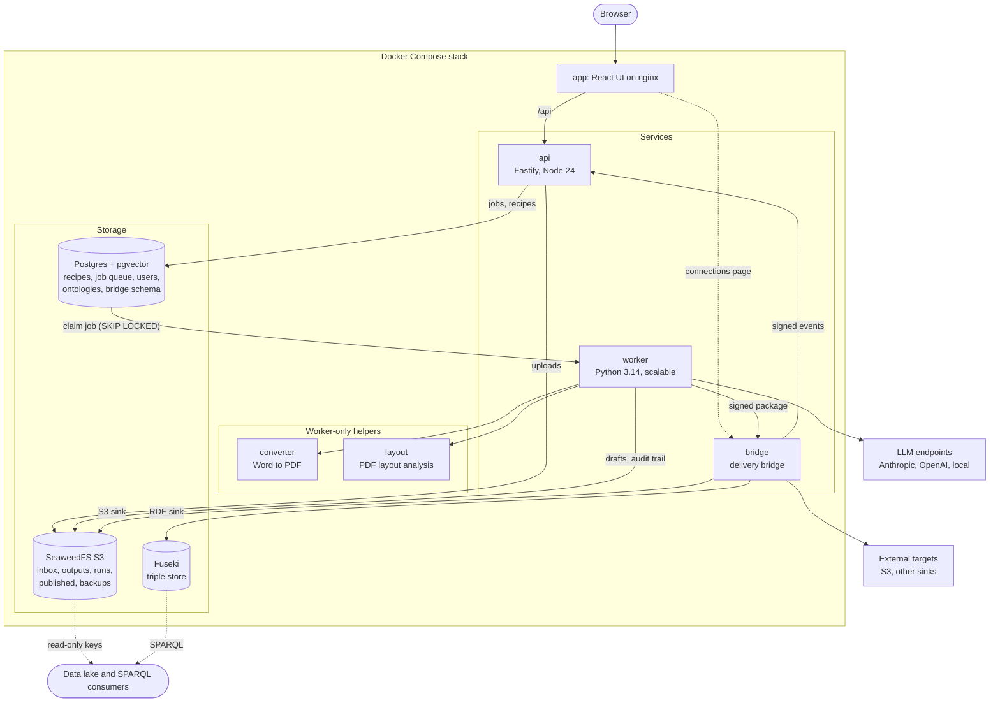

# Content Transformation Studio

[](https://github.com/kenhayward/ingestion-harness/actions/workflows/ci.yml)
[](LICENSE)

Content Transformation Studio (CT Studio) turns documents whose structure is known in advance
(PDFs and Word `.docx` files) into validated, structured data. Each kind of document has a
versioned **transformation recipe**: the fields and tables to extract, how the document is split
into sections, and an ordered pipeline of LLM extraction and check steps. The extracted data is
reviewed when the recipe asks for it, then delivered as **CSV / JSON** to S3-compatible storage,
as **RDF** to a triple store, or to other systems through the delivery bridge.

The code, packages and images keep the project's original name, `ingestion-harness`; see
[docs/brand/BRAND.md](docs/brand/BRAND.md).

## What it does

- **Extract**: reads each page's text layer, OCRs image-only pages with a vision model (default
  olmOCR 2), converts Word files to PDF first, segments the text by the recipe's section anchors,
  and runs one schema-constrained LLM call per step, validating each reply and retrying with the
  errors fed back.
- **Review**: a reviewer checks flagged values side by side with the page, edits them, and approves
  or rejects; every edit is recorded.
- **Deliver**: each publication goes through the delivery bridge as one package, to an S3
  publishing target, the Fuseki triple store (mapped to your ontologies, checked against SHACL
  shapes) or an external sink; a read-only key gives a data lake access to the outputs.
- **Design recipes**: the Workbench drafts a recipe from sample documents (survey, outputs,
  sections, pipeline, ontology mapping), measures it against verified references, and publishes
  it once it scores well on held-out samples.
- **Run any model**: Anthropic, OpenAI and any OpenAI-compatible local server (LM Studio, vLLM,
  Ollama, llama.cpp), configured by admins in the app. Projects marked local-only never reach an
  external model.
- **Convert**: the Conversion tab rebuilds batches of Word documents in a structured-authoring
  target, with no recipe or model involved.

## Architecture



1. **Upload.** The `api` checks the file, stores it in the **inbox** bucket and queues a job in
   Postgres, in one transaction.
2. **Process.** A `worker` claims the job with `SELECT … FOR UPDATE SKIP LOCKED` (idle workers
   wake on `NOTIFY`), converts Word sources, reads and OCRs the pages, runs the recipe's steps and
   writes draft outputs to **outputs** and every prompt and reply to **runs**.
3. **Review.** If the recipe's review policy says so, the job waits in `awaiting_review`; approving
   it queues a publish task that applies the reviewer's edits.
4. **Deliver.** The worker hands one signed package to the `bridge`, which delivers it to each of
   the recipe's publishing targets with retries and reports every status change back to the API
   as signed events; the job finishes once every delivery is final.

The API holds no LLM logic and the worker serves no HTTP. The `converter` and `layout` services
sit on internal networks shared only with the worker, with no route out. Credentials for
publishing targets live only on the bridge, encrypted. Full detail:
[docs/architecture.md](docs/architecture.md); decisions: [docs/adr/](docs/adr/).

## Repository layout

```
apps/api/                Fastify API (src/app.ts is the composition root)
apps/web/                React + Vite UI
apps/bridge/             Delivery bridge (own service and Postgres schema `bridge`)
packages/shared/         Zod schemas and types shared by api and web
packages/bridge-contract/  Public sink and producer contract of the bridge
worker/                  Python worker (uv); worker/plugins/ holds recipe plugin packages
specs/                   Seed recipes (template.yaml) and legacy spec.yaml versions
config/                  llm-providers.yaml: default providers, models, aliases
db/migrations/           Forward-only SQL migrations (api and worker)
deploy/                  Docker Compose, Dockerfiles, deploy and dev scripts (.sh + .ps1)
docs/                    Architecture, ADRs, designs, consumer and plugin guides, release notes
```

## Quick start

Prerequisites: Node 24, Python 3.14 with [uv](https://docs.astral.sh/uv/), Docker.

```bash
npm ci
cd worker && uv sync && cd ..
npm run check                       # lint, typecheck and every test (TypeScript + Python)
```

### Full stack in Docker

```bash
cp deploy/.env.example deploy/.env  # set the passwords and keys it marks as required
deploy/scripts/deploy.sh            # Windows: deploy\scripts\deploy.ps1
```

Open http://localhost:8081 and sign in as `admin` with the admin token the deploy script prints
(it changes on every API restart; `deploy/scripts/admin-token.sh` prints it again). Then, under
**Administration**, add an LLM endpoint and the models to offer, add users, and upload a document
from **Home**. Add `COMPOSE_PROFILES=rdf` to `deploy/.env` for the triple store. Operations,
backups and TLS: [deploy/README.md](deploy/README.md); Windows hosts:
[docs/deploy-windows.md](docs/deploy-windows.md).

### Services on the host

Run the infrastructure in containers and the services from source:

```bash
deploy/scripts/dev-infra.sh up      # Postgres, SeaweedFS, converter, Fuseki; migrations; buckets
npm run dev:api                     # :3000 (export the variables dev-infra prints first)
npm run dev:web                     # :5173, proxies /api
npm run dev:bridge                  # the delivery bridge
cd worker && uv run ingest-worker
```

## Adding a document type

Recipes are stored in the database and edited in the app; nothing needs a code change.

- **Workbench** (recommended): create a project, upload sample documents, and let it draft the
  recipe stage by stage; verify references, evaluate, then publish.
- **Document types** page: create a recipe by hand, edit its outputs, sections and pipeline (or
  its YAML), test-run it on a sample and publish it. Published versions are immutable; a change is
  a new version.
- **Import**: a recipe YAML, a Workbench bundle, or a recipe stored in GitHub.

`specs/<id>/v<N>/template.yaml` files are seeded on API start; the shipped example is
`specs/process-validation-protocol/`, developed against the public samples in
[docs/samples/](docs/samples/README.md). The format is described in
[specs/README.md](specs/README.md), and custom pipeline steps in
[docs/plugins/writing-plugins.md](docs/plugins/writing-plugins.md).

## Docs

- [docs/architecture.md](docs/architecture.md): components, job lifecycle, data flow, failure handling
- [docs/adr/](docs/adr/): architecture decision records
- [deploy/README.md](deploy/README.md): deployment and operations
- [docs/consumers/sparql.md](docs/consumers/sparql.md): reading published graphs over SPARQL
- [docs/plugins/writing-plugins.md](docs/plugins/writing-plugins.md): writing recipe plugins
- [docs/runners.md](docs/runners.md): CI (GitHub-hosted) and self-hosted deploy runners
- [docs/release-notes/](docs/release-notes/): what changed, by date
- API reference: `/api/docs/` on a running instance ([docs/openapi.json](docs/openapi.json))
- [CLAUDE.md](CLAUDE.md): working agreement, test-first workflow, commands and contracts

## Contributing

Contributions are welcome. See [CONTRIBUTING.md](CONTRIBUTING.md) for setup, the test-first
workflow and the PR process. Please follow the [code of conduct](CODE_OF_CONDUCT.md), and report
security issues privately as described in [SECURITY.md](SECURITY.md).

## License

Licensed under the [Apache License, Version 2.0](LICENSE). See [NOTICE](NOTICE) for attribution,
including the public sample documents in `docs/samples/`.
