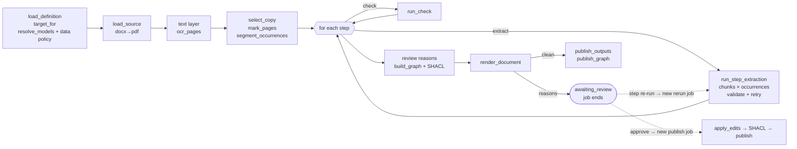
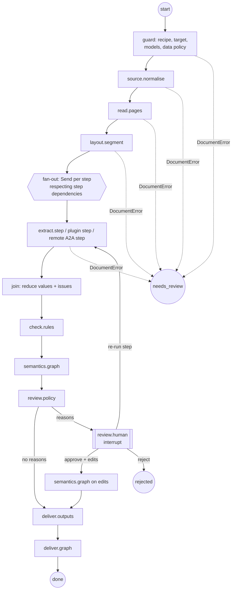

# Agent graph architecture (research)

Status: **research, no decision**. Written 2026-10-19. Nothing here is implemented; it explores
whether Content Transformation Studio (CT Studio) should split its capabilities into an
agent graph (LangGraph or similar), what the split would look like, and how the same split could
let outside agents use CT Studio, and be used by it, over the Agent2Agent (A2A) protocol.

## 1. Summary

- **CT Studio already works like a graph, but the graph is not written down anywhere.** The worker has 14 task kinds, each a function
  `fn(job, deps, queue)` dispatched by an if-chain in `main._run_claimed`. Outcomes are signalled
  by exception type (`DocumentError` → `needs_review`, `JobCancelled`, anything else → retry).
  The real orchestration is spread over three places: the step loop inside
  `template_pipeline.process_template_job`, the job chains the API drives
  (process → review → publish; draft stage → accept → next stage), and the drafting stage order
  that lives in TypeScript (`STAGE_ORDER`, `stageStates`, `applyChanges`).
- **The useful part of the idea is the node contract, not the framework.** Pluggable capabilities
  need four things: typed inputs and outputs, a declared side-effect and data-policy class,
  safe points for cancellation, and a registry the recipe can name. These can be built without
  committing to any framework, and they pay off even if no graph runtime is ever adopted.
- **Of the graph runtimes, LangGraph (the MIT library, not the Agent Server) fits best**, run
  *inside* the existing Postgres job queue, with `langgraph-checkpoint-postgres` on our own
  database. The Agent Server should not be adopted: it needs a licence key that phones home to
  `beacon.langchain.com`, it needs Redis, and it duplicates our queue, sign-in, SSE and data-policy
  enforcement. Its built-in A2A endpoint is also incomplete (no push notifications, JSON-RPC only).
- **A2A can be added to CT Studio on its own, without adopting LangGraph.** "CT Studio as an A2A agent" is a thin
  layer in the TypeScript API over uploads, jobs and results. "CT Studio calling A2A agents" is a
  new kind of node: a recipe step that hands work to a remote agent, under the same data-policy
  and host-allowlist rules that ontology fetches and external models follow today.
- **Recommended path** (§8): first refactor the worker into explicit nodes with no framework →
  run a LangGraph spike for `process` behind a flag, held to the regression suite → add a plugin
  registry and recipe `uses:` steps → expose CT Studio over A2A with machine credentials → move
  drafting conversations into subgraphs last.

## 2. What we have today (inventory)

Line counts are for `worker/src/ingest_worker/`, which totals about 19.3k lines.

### 2.1 Task kinds

| Task | Entry | LLM | Shape |
| --- | --- | --- | --- |
| `process` | `template_pipeline.process_template_job` | OCR vision, one `complete_json` per step | linear pipeline, fans out over steps, chunks and occurrences, ends in the review gate |
| `publish` | `publish_template_job` | none | applies review edits → SHACL → delivery → graph |
| `rerun` | `rerun_template_job` | one step | re-enters `process` at one step |
| `prepare` | `workbench.prepare_sample` | OCR | first half of `process` |
| `segment` | `workbench.run_segment` | none | pure, in a sandboxed child process (10 s) |
| `draft` | `drafting.run_draft` / `mapping_stage.run_mapping` | drafting model, conversations with tools | **agentic**: tool loop with `submit` |
| `graph` | `graph_preview.run_graph_preview` | none | RDF and SHACL over samples |
| `suggest`, `embed`, `ontology` | `ontology_suggest`, `embeddings`, `ontology` | embeddings | library housekeeping |
| `export`, `withdraw`, `republish`, `rebuild` | `bundle`, `withdrawal`, `rdf_rebuild` | none | operational, side effects only |

### 2.2 The production pipeline as an implicit graph



State between stages is kept in three places: in memory (`Prepared`, and the shared `fields`/`tables`/`issues`
dicts that `_normalise_step` mutates), in S3 (caches, drafts, audit trail), and in Postgres
(status, events, `step_runs`, `job_outputs`, the graph registry). **Human review ends the job**,
and the decision is a new job that reads S3 again. The S3 drafts and audit files already act as
checkpoints.

### 2.3 Cross-cutting machinery a graph runtime must respect (or replace)

| Concern | Where | Notes for a graph runtime |
| --- | --- | --- |
| Claim, priority, pause, `LISTEN ih_jobs` | `queue.CLAIM_SQL` | the outer scheduler; keep it |
| One job, one worker | `heartbeat.beating`, `reap_stale` | a graph run must stay inside one claim |
| Claim-guarded writes | `_MINE` clause | a cancel always wins; nodes must write through the queue port |
| Cancellation | `check_cancelled`, `checkpoint=` hooks | becomes "check between supersteps" plus in-node hooks |
| Retries | in-job schema retries, cross-job `backoff_seconds` | maps onto per-node `RetryPolicy`; `DocumentError` must *not* be retried |
| Data policy | `enforce_data_policy` in 4 places | must become a single egress gate that every plugin and remote agent goes through |
| Progress | `job_events` → `NOTIFY` → SSE | stays the user-facing channel; graph streaming feeds it |
| Caches | step cache (Workbench only), OCR cache, conversion cache | content-keyed: node-level memoisation, already deterministic |
| Child processes | segmentation, SHACL with timeouts | node implementations, not graph concerns |
| Advisory locks | `GraphRegistry.publish` | effectful node; must be idempotent on replay |

### 2.4 Seams (what helps, what hurts)

Helps: `PipelineDeps` is already a dataclass of ports (object store, model registry, targets,
converter, ontology, graph registry and store, mapping memory, …) with fakes for each.
`JobQueue`/`JobHeartbeat` are Protocols. `tool_loop.Tool` (spec, run, describe) is a ready-made
tool-node shape. Callbacks (`on_attempt`, `on_tokens`, `on_tool`, `checkpoint`, `transcript`) are
already injected.

Hurts:
1. `prepare_document` bundles convert, text, OCR, copy selection and segmentation into one call.
2. The step loop mutates shared dicts instead of returning values.
3. Status transitions are exceptions handled in one place (`main._run_claimed`), not return values.
4. `ProcessResult.deliver_graph` is a closure.
5. Drafting-stage sequencing, acceptance and staleness live in the TypeScript API.

All five need fixing whether or not a graph runtime is adopted. That is why the first phase is a
refactor that does not depend on any framework.

## 3. What "agent graph" should mean here

The term covers three different kinds of node, and they should not be confused:

| Node kind | Example today | Determinism | Should it be an "agent"? |
| --- | --- | --- | --- |
| **Workflow node**: deterministic code | convert, segment, render RDF, SHACL, publish | full | no; keep it plain and testable |
| **Bounded LLM node**: one schema-constrained call with validation retries | OCR page, extraction step, survey | pinned by temperature 0, step cache | no; it is a function with a model inside |
| **Agentic node**: a model choosing tools in a loop | sections and revise (`test_anchors`, `read_sample_pages`), mapping (`search_terms`, `term_detail`) | low | yes; this is where agent frameworks help |

Most of the production path is workflow and bounded LLM nodes, and that is a strength: regression
scores measure the recipe, not sampling noise. **The graph gives us a composition and plugin
model. It does not mean everything has to become autonomous.** Agentic behaviour belongs
where it already is: Workbench drafting and ontology mapping, plus new remote agents that are
explicitly delegated to.

## 4. Proposed decomposition

### 4.1 Capability catalogue

Each capability is a subgraph with a typed contract (Pydantic in, Pydantic out). Each one can also
be published as an A2A *skill* (§6).

**Runtime (document processing)**

| Capability | Today | Kind | Input → output | Side effects |
| --- | --- | --- | --- | --- |
| `source.normalise` | `load_source`, `convert` | workflow | inbox key → PDF ref + sha256 | conversion cache |
| `read.pages` | text layer, `ocr_pages` | bounded LLM (vision) | PDF ref, OCR policy → page texts | OCR cache, audit |
| `layout.segment` | `select_copy`, `mark_pages`, `segment_occurrences` | workflow (sandboxed) | pages, spec sections → sections, occurrences, key issues | none |
| `extract.step` | `run_step_extraction` / `run_extraction` | bounded LLM | section text, step, upstream values → values + issues | step runs, audit, step cache |
| `check.rules` | `run_check` | workflow | values → check results | events |
| `review.policy` | `_review_reasons` | workflow | issues, checks, policy → reasons | none |
| `semantics.graph` | `build_graph`, `shacl_check` | workflow | values, mapping, ontologies → Turtle + report | SHACL report |
| `review.human` | `awaiting_review` + `publish` job | **interrupt** | draft → decision + edits | review edits |
| `deliver.outputs` | `publish_outputs`, `record_published` | effectful | document → target objects | target, `job_outputs` |
| `deliver.graph` | `publish_graph` | effectful (locked) | Turtle → graph version | target, Fuseki, registry |

**Design time (Workbench)**

| Capability | Today | Kind | Tools |
| --- | --- | --- | --- |
| `design.survey` | draft stage `survey` | agentic-light | none (and queues `suggest`) |
| `design.outputs` | draft stage `outputs` | bounded LLM | none |
| `design.sections` | draft stage `sections` + anchor round | agentic | `test_anchors` |
| `design.pipeline` | draft stage `steps` | bounded LLM | none |
| `design.revise` | draft stage `revise` | agentic | `test_anchors`, `read_sample_pages` |
| `design.map` | `run_mapping` | agentic + retrieval | `search_terms`, `term_detail`, mapping memory |
| `design.suggest_ontologies` | `run_suggest` | retrieval | embeddings |
| `evaluate.score` | API (TS): references, scorecard, gate | workflow | none |

**Housekeeping** (ontology import, embed, withdraw, republish, rebuild, export, backup) stays as
plain queued jobs. These are not agent capabilities, and wrapping them in a graph adds nothing.

### 4.2 The production graph



What the graph adds compared with today:

- **Review stops being "end job, start another".** `review.human` calls `interrupt()`, and approval resumes the
  same thread with `Command(resume={edits})`. A step re-run becomes a *fork*: resume from the checkpoint
  after `layout.segment` with `Command(goto="extract", update={step, model, instructions})`.
  `rerun` and `publish` then stop being separate task kinds.
- **In-job resume after a redeploy.** Today the reaper re-queues a stale job and the whole job runs
  again (production does not use the step cache). With a node-level checkpoint, a resumed
  run skips steps that already finished. On long multi-step documents this is a real cost and
  latency gain.
- **Explicit fan-out.** Steps that do not depend on each other (`context_values` makes the dependencies
  visible) can run in parallel through LangGraph's `Send`. Today they run one after another.
- **Outcomes become routes, not exceptions.** `needs_review` is a terminal node that a routing
  function picks. It is no longer a `DocumentError` caught at the top of the stack.

### 4.3 The design-time graph

Two levels are needed:

1. **The stage subgraph** (worker): `build_context → ask (tool loop) → check/convert → anchor round →
   write proposal`. This is close to LangGraph's prebuilt ReAct pattern, but keeps our `submit`
   tool, the turn and tool-call caps, the model log and the checkpoints. It is the natural first
   agentic subgraph, because ADR 0016 already defines its contract.
2. **The project graph** (survey → outputs → sections → pipeline → references → evaluate → revise →
   mapping → publish, with accept/reject interrupts and staleness). Today this lives entirely in
   TypeScript and is deliberately derived, never stored (`stageStates`). Moving it into a LangGraph
   thread would mean either porting `applyChanges`/`stageStates` to Python (they are already held
   in step by shared fixtures) or running LangGraph.js in the API. **Recommendation: do not move
   it early.** The project graph is the user's map, not a machine-run workflow, so keep it derived
   in TypeScript and only make the stage *runs* graph-shaped.

### 4.4 The plugin model

The goal of extending by plugging in new capabilities needs a contract more than it needs a framework:

```text
NodeSpec
  id, version                 e.g. "table.detect@1"
  input_schema, output_schema Pydantic models (exported as JSON Schema for TS and A2A)
  kind                        workflow | llm | agentic | remote
  effects                     pure | cacheable(key fn) | effectful(idempotency key)
  egress                      none | model(ref) | remote(url)   ← checked by the data-policy gate
  progress_event              schema of its job_events payload
  safe_points                 where cancellation is checked
```

- **Registration:** Python entry points (`ct_studio.nodes`) loaded by the worker at start, listed
  for the API in a `nodes` table (as `llm_models` lists discovered models), so the recipe editor
  can offer them.
- **Use from a recipe:** the recipe's `pipeline` already compiles into the engine
  (`template.compile_step`). Add a step kind `uses: <node id>@<major>` with `with:` arguments
  that are validated against the node's input schema. **The recipe becomes the graph
  specification**, and a recipe version pins the node versions it ran with (as it pins prompts),
  which keeps "published is immutable" true.
- **Guardrails:** plugins never get raw provider clients or bucket credentials. They receive ports
  (the `ModelRegistry`, a scoped object store, the queue's event sink) so that data policy, the
  model allowlist, audit and claim-guarded writes cannot be bypassed. The step cache key gains
  the node id and version.

Plugin candidates that the existing research already points to: type detection (`detect.py`),
table-region detection before extraction, a second OCR engine (`docs/design/ocr-engines.md`),
value normalisers (units, dates) ahead of RDF, and a remote specialist agent (§6.2).

## 5. Runtime options

| Option | What it is | Fit | Concerns |
| --- | --- | --- | --- |
| **A. LangGraph library in the worker** (recommended spike) | `StateGraph`, `Send`, `interrupt`, `RetryPolicy`; checkpointer `langgraph-checkpoint-postgres` (Psycopg 3) on our Postgres | Python, MIT, mature HITL and checkpointing; our queue stays the outer scheduler; testable with `InMemorySaver` | Churn (1.x moves quickly); checkpoint growth (keep S3 *refs* in state, not page text); nodes after a checkpoint run again on resume, so effectful nodes must be idempotent; not adopting LangChain's model wrappers means some ecosystem pieces do not apply |
| B. LangGraph Agent Server (self-hosted) | REST, threads, runs, background queue, native A2A at `/a2a/{assistant_id}` | Least code for A2A | `LANGGRAPH_CLOUD_LICENSE_KEY` checked at start against `beacon.langchain.com` (breaks air-gapped and local-only deployments); requires Redis; duplicates our queue, sign-in, SSE and data policy; A2A has no push notifications or `SubscribeToTask`, JSON-RPC only, and needs a `messages` state key |
| C. Pydantic AI (+ its graph) | Typed agents; durable execution through Temporal, DBOS, Prefect or Restate; A2A through `fasta2a` (`agent_to_a2a`) | Matches our Pydantic and `mypy --strict` style | Graph layer less proven than LangGraph; durability needs another engine |
| D. Durable-execution engine (DBOS, Temporal) + our own node layer | Workflow and step semantics with exactly-once steps | DBOS is Postgres-native (no new infrastructure); Temporal is the strongest on durability | Temporal is a new cluster to run; neither gives agent primitives (we already have the tool loop) |
| E. Our own graph over the existing queue | The node contract (§4.4) plus a small executor (topological order, fan-out, routes) and S3/Postgres checkpoints | No dependency, fits ADR 0005 exactly | We maintain the executor; no ecosystem |
| F. Microsoft Agent Framework / Google ADK | Full agent stacks; ADK has native A2A | Good A2A story | Cloud-ecosystem pull (Azure or GCP), heavier, less natural for a local-first deployment |

**Rationale for A + E:** the node contract (E) is the lasting investment. LangGraph (A) is then
one possible executor, and could be replaced by DBOS (D) without rewriting nodes. Avoid B.
The Agent Server's value is mostly hosting, and we already have our own hosting, with stricter
rules.

### 5.1 Mapping our guarantees onto LangGraph

| Our guarantee | LangGraph mechanism | Gap |
| --- | --- | --- |
| One job, one worker | run the graph inside the claimed job; `thread_id` = job id | none, as long as the Agent Server is not used |
| Cancel wins | check `is_cancelled` between supersteps (a `before_node` wrapper) and keep the in-node `checkpoint=` hooks | no native cooperative cancel for in-process runs; raise `JobCancelled` from the wrapper |
| `DocumentError` not retried | per-node `RetryPolicy(retry_on=…)` excluding it; route to `needs_review` | none |
| Cross-job backoff | stays in `queue.fail` | none |
| Audit and progress events | node wrappers write `job_events`; `stream_mode="custom"` for tokens | none; do **not** use LangSmith (local-only data policy) — export OpenTelemetry instead |
| Durable review pause | `interrupt()` + Postgres checkpointer; job status stays `awaiting_review` | the node containing `interrupt()` runs again on resume, so keep the review node free of side effects |
| Immutable recipe versions | graph compiled from the pinned recipe version; store `graph_version` in state | a checkpoint written by older code and resumed by newer code needs a compatibility rule (refuse, or re-run from a safe point) |
| Data policy | single egress gate wrapping `ModelRegistry` and the A2A client | must be enforced in the ports, never trusted to plugins |

## 6. A2A: both directions

A2A v1.0 (Linux Foundation) defines an Agent Card at `/.well-known/agent-card.json`, which can be
signed with JWS/JCS. It also defines Tasks with a lifecycle (`working`, `input-required`,
`auth-required`, `completed`, `failed`, `canceled`, `rejected`), Messages and Artifacts made of
text, file or data Parts, and the operations `SendMessage`, `SendStreamingMessage`, `GetTask`,
`ListTasks`, `CancelTask`, `SubscribeToTask` and push-notification config. Bindings are JSON-RPC,
gRPC and HTTP+JSON. Security schemes are declared in the card (API key, HTTP, OAuth 2 including
client credentials, OIDC, mTLS).

MCP is the complement, not the competitor: MCP fits function-like tool and data access, A2A fits
delegating a *job* to a peer agent. CT Studio could plausibly offer both.

### 6.1 CT Studio as an A2A agent (inbound)

The work is a façade in the **TypeScript API**, which already owns uploads, sign-in, jobs, SSE
and results. It can be built with or without LangGraph.

| A2A | CT Studio |
| --- | --- |
| Agent Card skills | `extract-document` (one per published document type, or one skill with a `documentType` data part), `detect-document-type`, later `map-to-ontology`, `query-graph` |
| `SendMessage` with a file Part + data Part `{documentType, model?}` | `POST /api/documents` (via `checkSource`); returns a Task whose `id` maps to the job id |
| `contextId` | a batch (`params.batchId`) or the caller's conversation |
| `working` | `queued`, `running` (status message from `JobProgress`: "OCR 3 of 12", "Step 2 of 5") |
| `awaiting_review` | `working`, with status message "awaiting human review". Our reviewer is not the A2A client, so `input-required` would be wrong. An optional extension (`ct-studio/client-review`) could hand review to the caller as `input-required` |
| `needs_review` | `failed`, with the review reason (an operator problem), or held as `working` if the operator may fix it; this policy needs a decision |
| `succeeded` | `completed`, with Artifacts: JSON and CSV as file Parts (pre-signed URIs, or bytes under a size cap), Turtle when delivered, plus a data Part with the document values |
| `rejected` (review) | `rejected` |
| `cancelled` | `canceled` (`CancelTask` → the existing cancel route) |
| `SubscribeToTask` / streaming | the existing `GET /api/jobs/:id/events` SSE, re-shaped into A2A events |
| Push notifications | new: a webhook sender driven by `ih_job_changed` |

**Prerequisites that are not about A2A itself:**

- **Machine credentials.** ADR 0013 covers people (email and password sessions). A2A clients need
  service accounts with OAuth 2 client credentials or API keys, mapped to a role. An operator-like
  role is the natural fit, since its allow-list already matches upload, jobs and results. This
  needs its own ADR.
- The cross-site `Sec-Fetch-Site` refusal and the cookie rules (ADR 0012) do not apply to bearer-token
  clients. The access hook needs a second authentication path.
- Rate limits and quotas per client, and audit of which agent submitted what (`created_by` already exists).
- The Agent Card lists only published, unretired document types. The card should be regenerated when
  types change, and signed.

**Why not the Agent Server's built-in A2A:** it would expose the *graph*, not CT Studio. It would
sit behind the Agent Server's own sign-in instead of ours, skip `checkSource`, data policy and
retirement checks, and lack push notifications.

### 6.2 CT Studio calling A2A agents (outbound)

A `remote` node kind (§4.4): a recipe step `uses: a2a` with an agent-card URL and skill id, sending
section text or page images as Parts and reading a data-Part Artifact that is validated against
the step's output schema, exactly as an extraction reply is validated.

Rules carried over from what exists:

- **Data policy:** a remote agent is `external` unless an admin registers it as `local`
  (the same rule as `llm_endpoints.location`). A local-only project never calls an external agent,
  and the check happens before any call. Each call is an `external model call`-style event naming
  what was sent.
- **Host allowlist:** agent-card URLs follow the ontology fetch rules (`ontology_fetch.host_allowed`:
  https, public addresses, every redirect re-checked). Signed cards are verified.
- **Registry:** remote agents are admin-managed rows, like LLM endpoints (credentials encrypted under
  `LLM_SECRETS_KEY`). They are offered in the recipe editor only once curated.
- **Long tasks:** the node either streams or polls `GetTask` within the job's heartbeat. A remote
  `input-required` becomes our `needs_review`, never a silent wait.
- **Caching and regressions:** a remote step is not deterministic. Its output joins the audit trail,
  and it is excluded from the step cache unless the agent declares itself deterministic.

Remote nodes are also how the extension model reaches past this repository. A partner's specialist
extractor, or a team's in-house classifier, plugs in as a node without being deployed inside CT Studio.

## 7. Risks and open questions

1. **Two languages.** Orchestration in Python, while the project-level stage logic and every
   contract live in both languages (the CLAUDE.md contract table). A graph layer adds a new
   contract (node specs), which must be exported as JSON Schema and checked from TypeScript.
2. **Checkpoint size and duplication.** Page text and OCR for long scans in checkpoints would bloat
   Postgres. State should carry S3 keys. The outputs-bucket draft and the checkpoint must not
   disagree about which one is authoritative.
3. **Replay semantics.** Nodes after the last checkpoint run again. LLM nodes need memoisation in
   production too (today the step cache is Workbench-only by design), or a crash costs a repeated
   model call. Effectful nodes (delivery, graph publish) need idempotency keys. The graph
   registry's advisory lock already gives us part of this.
4. **Framework churn and lock-in.** LangGraph moves quickly (1.0 in Oct 2025). Keeping the node
   contract ours limits the blast radius.
5. **Testing discipline.** TDD with fakes still works: graphs compile with `InMemorySaver` and fake
   ports. A new kind of test is needed: *equivalence*. The graph executor must produce byte-identical
   outputs to today's path on the regression set before it replaces it.
6. **Plugin trust.** In-process Python plugins run with the worker's privileges. Third-party
   capabilities are safer as remote A2A nodes, or as plugins in a separate process with no credentials.
7. **Decisions needed:** how `needs_review` maps to A2A; whether `rerun`/`publish` disappear as task
   kinds; whether review moves into graph interrupts (it touches the API, web and migrations);
   the machine-credential model.

## 8. Phased path

| Phase | Goal | Scope | Done when |
| --- | --- | --- | --- |
| 0 | Decide | ADR "capabilities as nodes"; this document reviewed | ADR accepted |
| 1 | Explicit nodes, no framework ([worker-nodes-refactor.md](worker-nodes-refactor.md)) | split `prepare_document`; steps return values instead of mutating dicts; outcomes as values; `NodeSpec` + registry for built-ins | `npm run check` green, behaviour unchanged |
| 2 | LangGraph spike | `process` executed by a `StateGraph` behind a flag; Postgres checkpointer; cancel and heartbeat wrappers; resume after a killed worker | regression suite equivalent; resume skips finished steps; cancel still wins |
| 3 | Plugins | recipe `uses:` steps; node catalogue in the API and recipe editor; first plugin (type detection or table detection) | a plugin step runs in a published recipe, pinned by version |
| 4 | A2A inbound | service accounts ADR; Agent Card; `SendMessage`/`GetTask`/`CancelTask`/stream; push webhooks | an external A2A client processes a document end to end, honouring retirement and data policy |
| 5 | A2A outbound | remote-agent registry (admin), `uses: a2a` node with data-policy gate and allowlist | a recipe delegates one step to a registered remote agent |
| 6 | Agentic subgraphs | drafting stages and mapping as subgraphs; review as `interrupt` | drafting behaviour unchanged; model log and progress intact |

Phases 1 and 4 are independent, and each is useful on its own. Phase 2 is the point where the
framework choice becomes real, and can be dropped (in favour of option D or E) without losing
phases 1, 3 or 4.

## Sources

- LangGraph: [Interrupts](https://docs.langchain.com/oss/python/langgraph/interrupts),
  [Checkpointers and durability modes](https://docs.langchain.com/oss/python/langgraph/checkpointers),
  [Agent Server A2A endpoint](https://docs.langchain.com/langsmith/server-a2a),
  [Self-hosted standalone server](https://docs.langchain.com/langsmith/deploy-standalone-server),
  [forum: native A2A remote subgraphs (request)](https://forum.langchain.com/t/feature-request-native-support-for-a2a-protocol-remote-agents-as-sub-graphs/1521)
- A2A: [Specification (v1.0)](https://a2a-protocol.org/latest/specification/)
- Pydantic AI: [Durable execution](https://pydantic.dev/docs/ai/capabilities/durable_execution/overview/),
  [A2A](https://pydantic.dev/docs/ai/integrations/a2a/index.md)
- Comparisons (secondary): [Durable execution: LangGraph, DBOS, Inngest, Temporal](https://hackernoon.com/durable-execution-for-ai-agents-langgraph-dbos-inngest-and-temporal-compared),
  [Picking an AI agent framework in 2026 (AWS)](https://builder.aws.com/content/3AzsgG6TreTO3uLRqpWNxfEyUhe/picking-an-ai-agent-framework-in-2026)
